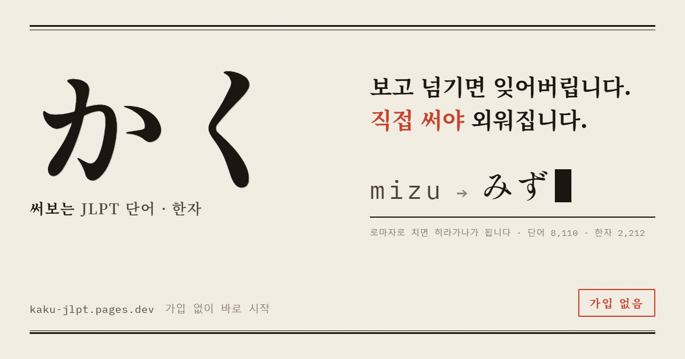

# かく (Kaku): 써보는 JLPT 단어장



한 줄 요약: JLPT를 준비하는 직장인·취업준비생이 자투리 시간에 폰으로 단어를 외울 때, 보고 넘기는 앱으로는 시험장에서 단어가 떠오르지 않는 문제를 풀기 위해, 한자를 보고 읽는 법을 직접 타이핑해 떠올리게 하는 무료 학습 웹앱(PWA)을 만들어 웹과 토스 미니앱으로 내놓았다.

공개 URL: https://kaku-jlpt.pages.dev (가입 없이 바로 사용) · 토스 앱 미니앱(앱인토스)으로도 출시

기획서와 기능명세(변경 이력 포함)는 [docs/](docs/)에 있습니다.

---

## 1. 문제 정의

**대상과 문제**: JLPT 준비생은 단어를 "보고, 아는 것 같으면 넘기는" 방식으로 공부하지만, 알아보는 능력(재인)과 스스로 떠올리는 능력(인출)은 달라서 시험지 앞에서 단어가 떠오르지 않는다.

- 플래시카드 앱은 "아는 것 같은 착각"을 만들고, 4지선다 앱은 알아보는 능력만 훈련한다.
- Anki는 강력하지만 덱 구성과 설정의 진입 장벽이 높다.
- 그래서 카쿠는 **한자를 보여주고 읽는 법을 로마자로 직접 입력하게** 한다. 입력은 히라가나로 실시간 변환되어 채점된다(`mizu` → `みず`).

**비즈니스 임팩트**: 무료 서비스라 매출이 아니라 **사용자 수**로 본다. 첫 지표 리딩(2026-08-14 ~ 2026-09-14) 기준으로 온보딩 첫 화면에 들어온 212명 중 첫 세션을 끝낸 사람은 35명이었다. 첫 세션 구간에서만 72명이 빠졌는데, 이는 들어온 사람 전체의 34%(72/212)다. 신규 유입을 늘리기 전에 이 구간을 고치는 것이 가장 싼 성장이라고 판단했다.

**성공 기준**: 온보딩 첫 세션 완료율(첫 세션 진입 대비 완료)을 기준선 **32.7%(35/107)에서 10%p 이상** 올린다. 10%p는 검증 설계(3장)의 표본 계산에 쓴 효과 크기다.

**Focus 지표와 선행지표**

| 구분 | 지표 | 정의 |
|---|---|---|
| Focus | 첫 세션 완료율 | `onboard_done` ÷ `onboard_session` |
| 선행 | 문항별 도달률 | 첫 세션 5문항 중 몇 번째까지 왔나 (`onboard_q1` ~ `onboard_q5`) |
| 선행 | 튜토리얼 통과율 | 튜토리얼 도달 대비 직접 통과·건너뜀 (`onboard_tut_ok` / `onboard_tut_skip`) |

제품 전체의 North Star는 **주간 정착 단어 수**(SRS 최고 단계에 도달한 단어 수)다. "공부한 시간"이 아니라 "실제로 외워진 양"을 재기 위해 골랐다.

---

## 2. 데이터

### 2-1. 학습 콘텐츠

| 데이터 | 출처 | 원본 | 앱 반영 | 주요 열 |
|---|---|---:|---:|---|
| 단어 | [Jonathan Waller, JLPT Resources](https://www.tanos.co.uk/jlpt/) (CC BY), 정리본 [open-anki-jlpt-decks](https://github.com/jamsinclair/open-anki-jlpt-decks) (MIT) | 8,131행 | 8,107개 | 표기, 읽기(히라가나), 한국어 뜻, 레벨 |
| 한자 | [KANJIDIC2](https://www.edrdg.org/wiki/index.php/KANJIDIC_Project) (EDRDG, CC BY-SA 4.0), 정리본 [kanji-data](https://github.com/davidluzgouveia/kanji-data) (MIT) | 13,108자 | 2,212자 | 한자, 음독, 훈독, 한국어 훈음, 예시 단어 |

**전처리**

- **단어**: 레벨별 CSV 5개 8,131행에서 표기·읽기가 같은 중복 97행을 지워 8,034개가 됐다. 직접 작성한 시드 단어와 합쳐 레벨별 출제 풀 합계는 8,107개다.
- **단어 표기 정제 350건**: 원본의 주석 표기(예: "とげ (をさす)")가 그대로 문제로 나오는 걸 실사용 중 발견했다. 괄호 주석은 제거하고, 병기된 표기는 첫 표기만 남기고, 읽기는 순수 히라가나로 통일했다. 이 과정에서 접미사 단어(~円)가 타이핑 정답이 될 수 없던 버그도 함께 고쳤다.
- **영어 뜻은 쓰지 않았다.** 한국어 뜻을 새로 작성했다(8,034건). 한자 훈음(예: 나라 국)도 새로 작성했다.
- **한자**: KANJIDIC 13,108자 중 JLPT 등급이 있는 2,211자만 남겼다. 그중 2,102자를 직접 작성한 시드 110자와 합쳐 2,212자가 됐다.

### 2-2. 행동 지표

| 항목 | 내용 |
|---|---|
| 수집 도구 | [GoatCounter](https://www.goatcounter.com) (익명, 쿠키 없음) |
| 이벤트 | 50여 종. 모든 이벤트에 `학습 목적 × 목표 레벨 × 시험일 유무` 세그먼트가 경로로 붙는다 |
| 기간 | 2026-08-14 ~ (온보딩 문항별 이벤트는 2026-09-14부터) |
| 자동 수집 | 비공개 저장소에서 매일 06:00(KST) GitHub Actions가 내보내기 API로 원본을 증분 수집하고 일별 리포트를 만든다 |
| 집계 기준 | 세션 × 경로 × 날짜 중복 제거(방문 기준, GoatCounter 화면 수치와 같음), 날짜는 KST |

가입이 없어 서버에 사용자 데이터가 없다. 그래서 D1/D7/D30 리텐션은 각 기기가 "첫 사용 후 며칠째인지"를 스스로 계산해 해당 날에 한 번만 신호를 보내는 방식으로 쟀다.

---

## 3. 분석과 검증

### 주장 1. 온보딩에서 비율로 가장 나쁜 구간은 첫 세션이다

| 단계 | 도달 | 이탈 | 이탈률 |
|---|---:|---:|---:|
| 환영 | 212 | | |
| 목적 선택 | 127 | 85 | 40.1% |
| 레벨 선택 | 120 | 7 | 5.5% |
| 시험일 | 119 | 1 | 0.8% |
| 첫 세션 진입 | 107 | 12 | 10.1% |
| 첫 세션 완료 | 35 | 72 | **67.3%** |

_기간: 2026-08-14 ~ 2026-09-14, 방문 기준_

- **사실**: 사람 수로는 첫 화면(85명)을 가장 많이 잃었다. 들어온 사람 대비 비율로는 첫 세션 구간(72/107)이 가장 높다.
- **해석**: 첫 화면 이탈은 "구경만 하고 나가는" 자연 이탈이 섞여 있다. 반면 첫 세션은 이미 목적·레벨·시험일까지 고른 사람이 빠지는 곳이라, 고칠 여지가 더 크다고 보고 비율 쪽을 먼저 팠다.

### 주장 2. 첫 세션에는 초보자만 갇히는 버그가 있었다

- **사실**: 브라우저로 재현했더니, 전부 틀리면 7문제를 풀어도 진행 표시가 "1/5", 진행 바가 0%에 고정되고 세션이 끝나지 않았다. 전부 맞히면 정상 종료됐다.
- **원인**: 진행 표시는 "끝낸 단어 수"(전체 − 남은 큐 − 1)인데, 틀린 단어를 큐에 되돌리는 로직이 함께 돌아 틀릴 때마다 표시가 상쇄됐다.
- **해석**: 로마자 입력이 처음인 사람일수록 틀릴 확률이 높으므로, 하필 처음 온 사람에게만 세션이 끝나지 않는 구조였다.

### 주장 3 (기각). 첫 화면 이탈은 로딩 속도 때문이다

- **사실**: 전송량은 압축 기준 205KB, 첫 화면 표시까지 1.1초로 측정됐다.
- **해석**: 이탈을 설명할 만큼 느리지 않아 기각했다. 첫 화면 이탈은 "정보량"이나 "무엇을 하게 될지 모르는 불확실성" 같은 제품 요인 가설로 남겨 두었다(미검증).

### 주장 4. 수정 후 첫 세션 완료율은 아직 오르지 않았다

| 단계 | 수정 전 (08-14 ~ 09-14) | 수정 후 (09-14 ~ 10-09) |
|---|---:|---:|
| 첫 세션 진입 | 107 | 18 |
| 첫 세션 완료 | 35 | 5 |
| **완료율** | **32.7%** | **27.8%** |

수정 후 세부 흐름:

| 단계 | 도달 |
|---|---:|
| 타이핑 튜토리얼 도달 | 26 |
| 튜토리얼 직접 통과 / 건너뜀 | 17 / 1 |
| 첫 세션 진입 (q1) | 18 |
| q2 | 15 |
| q3 | 11 |
| q4 | 7 |
| q5 | 5 |
| 완료 | 5 |

- **사실**: 완료율은 32.7%에서 27.8%로 4.9%p 낮다. 진입이 18명뿐이라 이 차이는 우연과 구분되지 않는다. 튜토리얼에 도달한 26명 중 8명(30.8%)이 통과도 건너뛰기도 하지 않고 나갔다. 문항별 이탈은 한 문제에 몰리지 않고 q2~q4에 퍼져 있다.
- **해석 1**: 버그를 고쳐 세션이 끝날 수 있게 됐는데도 완료율이 오르지 않았다. 버그는 실재했지만 **이탈의 주원인은 아니었을 가능성**이 높다.
- **해석 2**: 튜토리얼이 새로운 이탈 구간이 됐을 수 있다. 수정 전 "시험일 → 첫 세션" 이탈은 10.1%(12/119)였다.
- **해석 3**: 이탈이 특정 문항이 아니라 여러 문항에 퍼진 것은, 특정 단어의 난이도보다 세션 길이나 입력 부담 쪽 문제일 수 있다.

### 검증 방법과 고른 이유

- **A/B 테스트 대신 전후 비교**를 택했다.

| 항목 | 값 |
|---|---|
| 기준 완료율 | 32.7% |
| 확인하려는 개선 | +10%p |
| 조건 | 유의수준 5%, 검정력 80% |
| 필요 표본 | 그룹당 약 360명, 합계 약 720명 |
| 월 온보딩 진입 | 약 107명 |
| 걸리는 기간 | 약 7개월 |

- 버그 수정은 애초에 A/B 대상이 아니다. 망가진 것을 절반의 사용자에게만 고쳐줄 이유가 없다.
- 그래서 전후 비교로 가되 **"튜토리얼이 완료율을 올렸다" 같은 인과 주장은 하지 않기로** 했다. 대신 비교군이 필요 없는 진단 지표(문항별 도달률, 튜토리얼 통과율)를 함께 심었다.
- **지표 도구 자체도 검증했다.** GoatCounter 보조 통계 API가 기간의 끝일을 무시한다는 것을 실측으로 확인했다. 전체 316건, 기간 302건으로 차이가 14건이었고, 이는 첫날 이벤트 수와 정확히 같았다. 이후 두 시점 조회의 차분으로 기간 수치를 재구성했다.

---

## 4. 해결책

**어느 분석에서 나왔나**: 주장 1·2에서 다음 세 가지를 한 번에 배포했다(2026-09-14).

1. **온보딩 첫 세션은 재출제 없이 5문항 고정**: 약속한 "5문제"가 반드시 끝나게 했다. 일반 세션은 재출제를 유지하되 진행 표시를 "학습완료 N/M"으로 바꿔 멈춘 숫자의 의미가 읽히게 했다.
2. **문항별 계측**(`onboard_q1~q5`, 문항별 정답·오답): "5문항 중 몇 번째에서 나갔는지" 볼 수 없던 계측 공백을 메웠다.
3. **타이핑 튜토리얼**: 채점되는 첫 문제 앞에 실패할 수 없는 연습 한 칸을 넣었다(水를 보여주고 `mizu`를 치게 함). 갇히지 않도록 10초 무입력이나 8자 초과 입력 시 "그냥 시작하기" 탈출구를 열었다.

**누가 무엇을 하면 어느 지표가 움직이나**

- **목표**: 첫 세션 완료율 32.7% → 42.7% 이상(+10%p)
- **현재**: 27.8%(n=18)로 미달
- **다음 검증 후보**: 주장 4에서 나온 두 가지다. 아직 결정 전이다.
  - 튜토리얼 이탈(8/26)을 줄이는 쪽: 튜토리얼 축소 또는 생략 비교
  - 세션 부담을 줄이는 쪽: 첫 세션 문항 수 조정
  - 문항별 정답·오답 이벤트로 "틀린 직후 나가는가"를 먼저 확인한 뒤 고른다.

**사용자 확인**

| 누가 | 발견·반응 | 반영 |
|---|---|---|
| 배포 당일 실사용 테스트 | 피드백 5건 전부가 실기기에서만 드러나는 문제(키보드가 입력칸을 가림, 온보딩 반복 등) | 당일 반영 |
| 본인 iPhone 실기기 | 사파리에서 쌓은 기록이 홈 화면 앱으로 넘어가지 않음(iOS 저장소 분리) | 안내 순서를 "먼저 홈 화면에 추가하고 시작"으로 뒤집음 |
| 커뮤니티 제보 | "根拠(こんきょ)를 '4글자'로 표기하면 박자를 오해한다" | 박 수 규칙으로 교체 후, 힌트가 정답 길이를 누설한다고 판단해 이틀 뒤 힌트 자체를 제거 |
| 본인 iPhone 실기기 | 시험일을 고르지 않고 나와도 오늘 날짜가 저장됨 | 달력 대신 JLPT 고정 일정(7월·12월 첫째 일요일) 버튼 2개로 교체 |
| 사용자 제보 | 長編을 `cyouhenn`으로 치면 오답 처리됨 | 로마자 변환표에 `cya·cyu·cyo` 추가, 당일 배포 |

---

## 5. 한계

- **표본이 작다.** 수정 후 첫 세션 진입은 18명이라 완료율 비교는 방향만 본다.
- **변경이 겹쳤다.** 2026-09-17에 디자인을 전면 교체했고, 이는 온보딩 수정의 측정 창과 겹친다. 이후 퍼널 변화는 두 변경 중 어느 쪽 효과인지 분리할 수 없다.
- **테스트 이벤트가 섞였다.** 2026-09-14 배포 검증 때 실서비스에서 온보딩을 직접 진행해, 단계별로 1건 안팎의 테스트 이벤트가 수정 후 수치에 섞여 있다.
- **집계 단위가 기기다.** 한 사람이 폰과 PC를 쓰면 2명으로 잡히고, 브라우저 데이터를 지우면 신규로 잡힌다. 웹과 토스 미니앱도 저장 공간이 따로라 별개 사용자로 잡힌다.
- **원본 히트는 2026-09-14 22:20(KST) 이후만 있다.** 그 전 기간은 GoatCounter 집계치로만 볼 수 있다.
- **한국어 뜻은 전수 검수하지 않았다.** 8,034건 중 제보와 실사용으로 발견된 것만 고쳤다.
- **핵심 가설은 아직 검증 전이다.** "직접 써서 떠올린 단어가 고르기만 한 단어보다 오래 남는다"는 가설(H1)은 앱에 두 방식이 모두 있어 검증할 수 있게 설계만 해 두었다.

---

## 6. 실행법과 폴더 구조

**실행**: 빌드 과정이 없다. `index.html`을 브라우저로 열면 된다. 서비스워커까지 확인하려면 로컬 서버로 연다.

```bash
python -m http.server 8777
```

**배포**: `main`에 푸시하면 Cloudflare Pages가 자동 배포한다(빌드 명령 없음, 루트 디렉터리 그대로).

**토스 미니앱 빌드**: 웹 소스는 하나로 유지하고, 빌드 스크립트가 복사본에만 토스 모드 플래그를 심는다.

```bash
cd toss && npm install && npm run build
```

결과물은 `toss/kaku-jlpt.ait`이고, 앱인토스 콘솔에 업로드한다.

```
.
├── index.html            # 앱 전체 (바닐라 JS 단일 파일, 프레임워크·빌드 없음)
├── data.js               # 직접 작성한 시드 단어·한자
├── data_jlpt.js          # JLPT N5~N1 단어 (한국어 뜻)
├── data_kanji.js         # JLPT 한자 (음독·훈독·한국어 훈음·예시)
├── sw.js                 # 서비스워커 (앱 셸은 네트워크 우선)
├── manifest.webmanifest  # PWA 설정
├── icons/                # 아이콘, 공유 미리보기 이미지
├── docs/                 # 제품 기획서, 기능 명세 (변경 이력 누적)
└── toss/                 # 앱인토스 포장 (build.mjs, apps-in-toss.config.ts)
```

원본 데이터(`source/`), 번역 작업 파일(`trans/`), 운영자용 지표 대시보드(`analytics/`)는 저장소에 올리지 않았다.

---

## 7. AI 사용 공개

**쓴 도구와 쓴 곳**: Claude Code(Anthropic)를 페어 프로그래머로 썼다.

- **코드 전반**: 앱 코드, 로마자→히라가나 변환기, SRS, 지표 이벤트, 자동 수집 스크립트, 토스 포장
- **데이터**: 원본 데이터 정제 스크립트와 한국어 뜻·훈음 초안 작성
- **분석 보조**: 표본 수 계산, 버그 재현, 지표 API 실측 대조
- **이미지 생성**: 디자인 시스템 구현과 공유 이미지·스크린샷 생성

**핵심 프롬프트** (실제로 쓴 요청)

- "3번부터하자 어디서 나가는지 보자": 이탈 위치를 문항 단위로 계측하는 작업의 출발점
- "로딩 속도는 그렇게 크게 문제가 안되는거 같은데? 정보량 아니면 기대 불확실성이 더 이탈하는 부분 같은데 ?": 로딩 가설을 실측으로 기각하고 제품 요인 가설로 전환
- "온보딩 시작하기 전 실 문제 풀기전에, 하나의 튜토리얼 단계를 넣어주면 어떨까? 한자 주고, 알파벳을 입력하세요 이런식으로": 타이핑 튜토리얼 설계
- "배포하자, 지금 우리가 한게 A/B테스트야?": A/B 표본 계산과 전후 비교 결정으로 이어진 질문

**사람이 검증하거나 고친 곳**

- **실기기 검수**: 폰으로 직접 써서 iOS 저장소 분리, iOS 날짜 자동 채움, 디자인 교체 후 화면 8건을 찾아 고치게 했다. 브라우저 테스트로는 나오지 않는 문제들이다.
- **결정**: 디자인 방향(세 후보 중 활판·타자기), 측정 창과 겹치는 줄 알면서 디자인을 배포한 시점, A/B 대신 전후 비교, 박 수 힌트 제거, 로그인 없이 토스에 올리는 방식은 사람이 정했다.
- **가설**: 이탈 원인 가설(정보량·기대 불확실성)과 튜토리얼 아이디어는 사람이 먼저 냈다. AI가 먼저 낸 가설을 받아쓰지 않는 것을 원칙으로 했다.
- **검증하지 못한 곳**: AI가 만든 한국어 뜻 초안은 전수 검수하지 못했다(5장).

---

## 8. 나의 역할

1인 프로젝트다. 기획, 개발, 배포, 지표 설계와 운영을 모두 맡았다.

**내가 내린 결정**

- **타이핑 인출을 옵션이 아닌 기본 동작으로**: 고르기 모드는 초반 눈익힘용 보조로만 둔다.
- **가입·로그인 없음**: 신생 서비스에서 가입 장벽은 전환을 무너뜨린다. 세그먼트는 온보딩의 익명 질문 하나(학습 목적)로 해결했다.
- **엄격한 streak**: 앱을 열기만 해도 유지되는 게 아니라, 일일 목표(기본 10문항)를 채워야 유지된다. "출석"이 아니라 "달성"을 습관으로 만들기 위해서다.
- **계측은 개입보다 먼저**: 홍보 전에 유입 채널 태그를 심었고, 설치 안내를 넣기 전에 설치율 0을 기준선으로 확보했다.
- **호스팅 이전**: Netlify 무료 배포 크레딧이 소진되자 Cloudflare Pages로 옮겼다. 빌드 의존성이 없고 경로가 전부 상대 경로라 10분 만에 끝났다.
- **토스 미니앱 출시**: 웹 소스를 둘로 나누지 않고 빌드 시 플래그로 분기했다.

---

## 출처와 라이선스

- **단어 목록**: [Jonathan Waller, JLPT Resources](https://www.tanos.co.uk/jlpt/) (Creative Commons BY)
- **단어 정리본**: [open-anki-jlpt-decks](https://github.com/jamsinclair/open-anki-jlpt-decks) (Copyright (c) 2020 Jamie Sinclair, MIT License)
- **한자 읽기**: [KANJIDIC2](https://www.edrdg.org/wiki/index.php/KANJIDIC_Project). Electronic Dictionary Research and Development Group(EDRDG) 소유로, [EDRDG 라이선스](https://www.edrdg.org/edrdg/licence.html)에 따라 사용했다. 이 저장소의 한자 읽기 데이터는 같은 CC BY-SA 4.0 조건으로 제공한다.
- **한자 정리본**: [kanji-data](https://github.com/davidluzgouveia/kanji-data) (Copyright (c) 2019 David Gouveia, MIT License)
- **한국어 뜻·훈음**: 직접 작성
- **글꼴**: Shippori Mincho, Noto Serif KR, IBM Plex Sans KR, IBM Plex Mono (SIL Open Font License 1.1)
- **앱 안 표시**: 설정 → 출처·라이선스 화면에 같은 내용을 표시한다.
- **JLPT 관련**: JLPT(日本語能力試験)는 국제교류기금과 일본국제교육지원협회(JEES)가 주최하는 시험이다. 이 프로젝트는 두 기관과 관계없으며 기출 문제를 담고 있지 않다.
